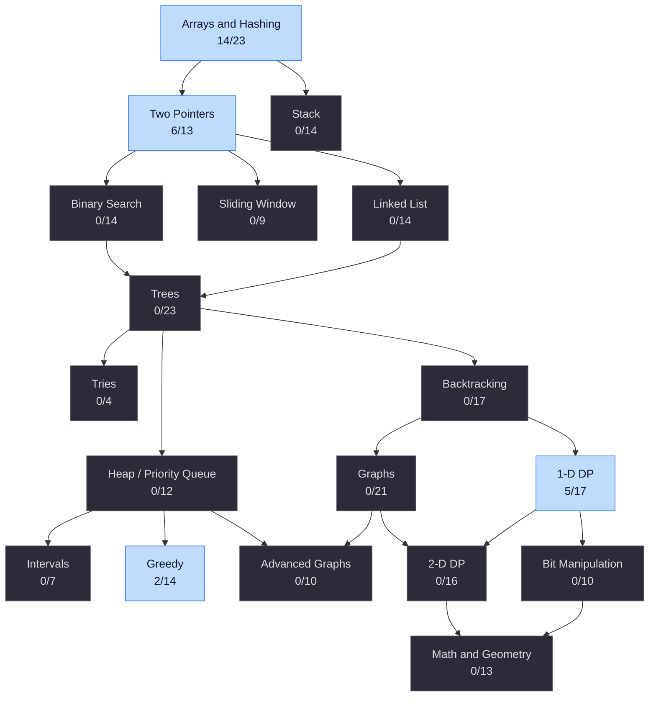

# NeetCode 250 — Progress Tracker

My progress through the [NeetCode 250](https://neetcode.io/practice/neetcode250), a curated set of LeetCode problems covering the core data structures and algorithms.

Solutions are written in Python and stored in one notebook per category in [`notebooks/`](notebooks).

<!-- graph:start -->

<!-- graph:end -->

**Legend:** ⬜ not started · 📖 attempted / needs review · ✅ solved · 🔒 requires LeetCode Premium

## Progress

<!-- progress:start -->
| # | Category | Solved |
|:-:|----------|:------:|
| 01 | [Arrays & Hashing](#01-arrays--hashing) | 14 / 23 |
| 02 | [Two Pointers](#02-two-pointers) | 6 / 13 |
| 03 | [Sliding Window](#03-sliding-window) | 0 / 9 |
| 04 | [Stack](#04-stack) | 0 / 14 |
| 05 | [Binary Search](#05-binary-search) | 0 / 14 |
| 06 | [Linked List](#06-linked-list) | 0 / 14 |
| 07 | [Trees](#07-trees) | 0 / 23 |
| 08 | [Heap / Priority Queue](#08-heap--priority-queue) | 0 / 12 |
| 09 | [Backtracking](#09-backtracking) | 0 / 17 |
| 10 | [Tries](#10-tries) | 0 / 4 |
| 11 | [Graphs](#11-graphs) | 0 / 21 |
| 12 | [Advanced Graphs](#12-advanced-graphs) | 0 / 10 |
| 13 | [1-D Dynamic Programming](#13-1-d-dynamic-programming) | 5 / 17 |
| 14 | [2-D Dynamic Programming](#14-2-d-dynamic-programming) | 0 / 16 |
| 15 | [Greedy](#15-greedy) | 2 / 14 |
| 16 | [Intervals](#16-intervals) | 0 / 7 |
| 17 | [Math & Geometry](#17-math--geometry) | 0 / 13 |
| 18 | [Bit Manipulation](#18-bit-manipulation) | 0 / 10 |
| | **Total (unique problems)** | **1 / 250** |
<!-- progress:end -->

---

## 01 Arrays & Hashing

Notebook: [01_arrays-and-hashing.ipynb](notebooks/01_arrays-and-hashing.ipynb)

| # | Problem | Difficulty | LeetCode | Status |
|:-:|---------|:----------:|:--------:|:------:|
| 1 | Concatenation of Array | Easy | [LC1929](https://leetcode.com/problems/concatenation-of-array) | ✅ |
| 2 | Contains Duplicate | Easy | [LC0217](https://leetcode.com/problems/contains-duplicate) | ✅ |
| 3 | Valid Anagram | Easy | [LC0242](https://leetcode.com/problems/valid-anagram) | ✅ |
| 4 | Two Sum | Easy | [LC0001](https://leetcode.com/problems/two-sum) | ✅ |
| 5 | Longest Common Prefix | Easy | [LC0014](https://leetcode.com/problems/longest-common-prefix) | ✅ |
| 6 | Remove Duplicates from Sorted Array | Easy | [LC0026](https://leetcode.com/problems/remove-duplicates-from-sorted-array) | ✅ |
| 7 | Remove Element | Easy | [LC0027](https://leetcode.com/problems/remove-element) | ✅ |
| 8 | Majority Element | Easy | [LC0169](https://leetcode.com/problems/majority-element) | ✅ |
| 9 | Design HashSet | Easy | [LC0705](https://leetcode.com/problems/design-hashset) | ✅ |
| 10 | Design HashMap | Easy | [LC0706](https://leetcode.com/problems/design-hashmap) | ✅ |
| 11 | Group Anagrams | Medium | [LC0049](https://leetcode.com/problems/group-anagrams) | ✅ |
| 12 | Sort an Array | Medium | [LC0912](https://leetcode.com/problems/sort-an-array) | ✅ |
| 13 | Sort Colors | Medium | [LC0075](https://leetcode.com/problems/sort-colors) | ✅ |
| 14 | Top K Frequent Elements | Medium | [LC0347](https://leetcode.com/problems/top-k-frequent-elements) | ✅ |
| 15 | Encode and Decode Strings 🔒 | Medium | [LC0271](https://leetcode.com/problems/encode-and-decode-strings) | ⬜ |
| 16 | Range Sum Query 2D - Immutable | Medium | [LC0304](https://leetcode.com/problems/range-sum-query-2d-immutable) | ⬜ |
| 17 | Product of Array Except Self | Medium | [LC0238](https://leetcode.com/problems/product-of-array-except-self) | ⬜ |
| 18 | Valid Sudoku | Medium | [LC0036](https://leetcode.com/problems/valid-sudoku) | ⬜ |
| 19 | Longest Consecutive Sequence | Medium | [LC0128](https://leetcode.com/problems/longest-consecutive-sequence) | ⬜ |
| 20 | Best Time to Buy and Sell Stock II | Medium | [LC0122](https://leetcode.com/problems/best-time-to-buy-and-sell-stock-ii) | ⬜ |
| 21 | Majority Element II | Medium | [LC0229](https://leetcode.com/problems/majority-element-ii) | ⬜ |
| 22 | Subarray Sum Equals K | Medium | [LC0560](https://leetcode.com/problems/subarray-sum-equals-k) | ⬜ |
| 23 | First Missing Positive | Hard | [LC0041](https://leetcode.com/problems/first-missing-positive) | ⬜ |

[↑ Back to top](#neetcode-250--progress-tracker)

---

## 02 Two Pointers

Notebook: [02_two-pointers.ipynb](notebooks/02_two-pointers.ipynb)

| # | Problem | Difficulty | LeetCode | Status |
|:-:|---------|:----------:|:--------:|:------:|
| 1 | Reverse String | Easy | [LC0344](https://leetcode.com/problems/reverse-string) | ✅ |
| 2 | Valid Palindrome | Easy | [LC0125](https://leetcode.com/problems/valid-palindrome) | ✅ |
| 3 | Valid Palindrome II | Easy | [LC0680](https://leetcode.com/problems/valid-palindrome-ii) | ✅ |
| 4 | Merge Strings Alternately | Easy | [LC1768](https://leetcode.com/problems/merge-strings-alternately) | ✅ |
| 5 | Merge Sorted Array | Easy | [LC0088](https://leetcode.com/problems/merge-sorted-array) | ✅ |
| 6 | Remove Duplicates from Sorted Array | Easy | [LC0026](https://leetcode.com/problems/remove-duplicates-from-sorted-array) | ✅ |
| 7 | Two Sum II - Input Array Is Sorted | Medium | [LC0167](https://leetcode.com/problems/two-sum-ii-input-array-is-sorted) | ⬜ |
| 8 | 3Sum | Medium | [LC0015](https://leetcode.com/problems/3sum) | ⬜ |
| 9 | 4Sum | Medium | [LC0018](https://leetcode.com/problems/4sum) | ⬜ |
| 10 | Rotate Array | Medium | [LC0189](https://leetcode.com/problems/rotate-array) | ⬜ |
| 11 | Container With Most Water | Medium | [LC0011](https://leetcode.com/problems/container-with-most-water) | ⬜ |
| 12 | Boats to Save People | Medium | [LC0881](https://leetcode.com/problems/boats-to-save-people) | ⬜ |
| 13 | Trapping Rain Water | Hard | [LC0042](https://leetcode.com/problems/trapping-rain-water) | ⬜ |

[↑ Back to top](#neetcode-250--progress-tracker)

---

## 03 Sliding Window

Notebook: [03_sliding-window.ipynb](notebooks/03_sliding-window.ipynb)

| # | Problem | Difficulty | LeetCode | Status |
|:-:|---------|:----------:|:--------:|:------:|
| 1 | Contains Duplicate II | Easy | [LC0219](https://leetcode.com/problems/contains-duplicate-ii) | ⬜ |
| 2 | Best Time to Buy and Sell Stock | Easy | [LC0121](https://leetcode.com/problems/best-time-to-buy-and-sell-stock) | ⬜ |
| 3 | Longest Substring Without Repeating Characters | Medium | [LC0003](https://leetcode.com/problems/longest-substring-without-repeating-characters) | ⬜ |
| 4 | Longest Repeating Character Replacement | Medium | [LC0424](https://leetcode.com/problems/longest-repeating-character-replacement) | ⬜ |
| 5 | Permutation in String | Medium | [LC0567](https://leetcode.com/problems/permutation-in-string) | ⬜ |
| 6 | Minimum Size Subarray Sum | Medium | [LC0209](https://leetcode.com/problems/minimum-size-subarray-sum) | ⬜ |
| 7 | Find K Closest Elements | Medium | [LC0658](https://leetcode.com/problems/find-k-closest-elements) | ⬜ |
| 8 | Minimum Window Substring | Hard | [LC0076](https://leetcode.com/problems/minimum-window-substring) | ⬜ |
| 9 | Sliding Window Maximum | Hard | [LC0239](https://leetcode.com/problems/sliding-window-maximum) | ⬜ |

[↑ Back to top](#neetcode-250--progress-tracker)

---

## 04 Stack

Notebook: [04_stack.ipynb](notebooks/04_stack.ipynb)

| # | Problem | Difficulty | LeetCode | Status |
|:-:|---------|:----------:|:--------:|:------:|
| 1 | Baseball Game | Easy | [LC0682](https://leetcode.com/problems/baseball-game) | ⬜ |
| 2 | Valid Parentheses | Easy | [LC0020](https://leetcode.com/problems/valid-parentheses) | ⬜ |
| 3 | Implement Stack Using Queues | Easy | [LC0225](https://leetcode.com/problems/implement-stack-using-queues) | ⬜ |
| 4 | Implement Queue Using Stacks | Easy | [LC0232](https://leetcode.com/problems/implement-queue-using-stacks) | ⬜ |
| 5 | Min Stack | Medium | [LC0155](https://leetcode.com/problems/min-stack) | ⬜ |
| 6 | Evaluate Reverse Polish Notation | Medium | [LC0150](https://leetcode.com/problems/evaluate-reverse-polish-notation) | ⬜ |
| 7 | Asteroid Collision | Medium | [LC0735](https://leetcode.com/problems/asteroid-collision) | ⬜ |
| 8 | Daily Temperatures | Medium | [LC0739](https://leetcode.com/problems/daily-temperatures) | ⬜ |
| 9 | Online Stock Span | Medium | [LC0901](https://leetcode.com/problems/online-stock-span) | ⬜ |
| 10 | Car Fleet | Medium | [LC0853](https://leetcode.com/problems/car-fleet) | ⬜ |
| 11 | Simplify Path | Medium | [LC0071](https://leetcode.com/problems/simplify-path) | ⬜ |
| 12 | Decode String | Medium | [LC0394](https://leetcode.com/problems/decode-string) | ⬜ |
| 13 | Maximum Frequency Stack | Hard | [LC0895](https://leetcode.com/problems/maximum-frequency-stack) | ⬜ |
| 14 | Largest Rectangle in Histogram | Hard | [LC0084](https://leetcode.com/problems/largest-rectangle-in-histogram) | ⬜ |

[↑ Back to top](#neetcode-250--progress-tracker)

---

## 05 Binary Search

Notebook: [05_binary-search.ipynb](notebooks/05_binary-search.ipynb)

| # | Problem | Difficulty | LeetCode | Status |
|:-:|---------|:----------:|:--------:|:------:|
| 1 | Binary Search | Easy | [LC0704](https://leetcode.com/problems/binary-search) | ⬜ |
| 2 | Search Insert Position | Easy | [LC0035](https://leetcode.com/problems/search-insert-position) | ⬜ |
| 3 | Guess Number Higher or Lower | Easy | [LC0374](https://leetcode.com/problems/guess-number-higher-or-lower) | ⬜ |
| 4 | Sqrt(x) | Easy | [LC0069](https://leetcode.com/problems/sqrtx) | ⬜ |
| 5 | Search a 2D Matrix | Medium | [LC0074](https://leetcode.com/problems/search-a-2d-matrix) | ⬜ |
| 6 | Koko Eating Bananas | Medium | [LC0875](https://leetcode.com/problems/koko-eating-bananas) | ⬜ |
| 7 | Capacity to Ship Packages Within D Days | Medium | [LC1011](https://leetcode.com/problems/capacity-to-ship-packages-within-d-days) | ⬜ |
| 8 | Find Minimum in Rotated Sorted Array | Medium | [LC0153](https://leetcode.com/problems/find-minimum-in-rotated-sorted-array) | ⬜ |
| 9 | Search in Rotated Sorted Array | Medium | [LC0033](https://leetcode.com/problems/search-in-rotated-sorted-array) | ⬜ |
| 10 | Search in Rotated Sorted Array II | Medium | [LC0081](https://leetcode.com/problems/search-in-rotated-sorted-array-ii) | ⬜ |
| 11 | Time Based Key-Value Store | Medium | [LC0981](https://leetcode.com/problems/time-based-key-value-store) | ⬜ |
| 12 | Split Array Largest Sum | Hard | [LC0410](https://leetcode.com/problems/split-array-largest-sum) | ⬜ |
| 13 | Median of Two Sorted Arrays | Hard | [LC0004](https://leetcode.com/problems/median-of-two-sorted-arrays) | ⬜ |
| 14 | Find in Mountain Array | Hard | [LC1095](https://leetcode.com/problems/find-in-mountain-array) | ⬜ |

[↑ Back to top](#neetcode-250--progress-tracker)

---

## 06 Linked List

Notebook: [06_linked-list.ipynb](notebooks/06_linked-list.ipynb)

| # | Problem | Difficulty | LeetCode | Status |
|:-:|---------|:----------:|:--------:|:------:|
| 1 | Reverse Linked List | Easy | [LC0206](https://leetcode.com/problems/reverse-linked-list) | ⬜ |
| 2 | Merge Two Sorted Lists | Easy | [LC0021](https://leetcode.com/problems/merge-two-sorted-lists) | ⬜ |
| 3 | Linked List Cycle | Easy | [LC0141](https://leetcode.com/problems/linked-list-cycle) | ⬜ |
| 4 | Reorder List | Medium | [LC0143](https://leetcode.com/problems/reorder-list) | ⬜ |
| 5 | Remove Nth Node From End of List | Medium | [LC0019](https://leetcode.com/problems/remove-nth-node-from-end-of-list) | ⬜ |
| 6 | Copy List with Random Pointer | Medium | [LC0138](https://leetcode.com/problems/copy-list-with-random-pointer) | ⬜ |
| 7 | Add Two Numbers | Medium | [LC0002](https://leetcode.com/problems/add-two-numbers) | ⬜ |
| 8 | Find the Duplicate Number | Medium | [LC0287](https://leetcode.com/problems/find-the-duplicate-number) | ⬜ |
| 9 | Reverse Linked List II | Medium | [LC0092](https://leetcode.com/problems/reverse-linked-list-ii) | ⬜ |
| 10 | Design Circular Queue | Medium | [LC0622](https://leetcode.com/problems/design-circular-queue) | ⬜ |
| 11 | LRU Cache | Medium | [LC0146](https://leetcode.com/problems/lru-cache) | ⬜ |
| 12 | LFU Cache | Hard | [LC0460](https://leetcode.com/problems/lfu-cache) | ⬜ |
| 13 | Merge K Sorted Lists | Hard | [LC0023](https://leetcode.com/problems/merge-k-sorted-lists) | ⬜ |
| 14 | Reverse Nodes in K-Group | Hard | [LC0025](https://leetcode.com/problems/reverse-nodes-in-k-group) | ⬜ |

[↑ Back to top](#neetcode-250--progress-tracker)

---

## 07 Trees

Notebook: [07_trees.ipynb](notebooks/07_trees.ipynb)

| # | Problem | Difficulty | LeetCode | Status |
|:-:|---------|:----------:|:--------:|:------:|
| 1 | Binary Tree Inorder Traversal | Easy | [LC0094](https://leetcode.com/problems/binary-tree-inorder-traversal) | ⬜ |
| 2 | Binary Tree Preorder Traversal | Easy | [LC0144](https://leetcode.com/problems/binary-tree-preorder-traversal) | ⬜ |
| 3 | Binary Tree Postorder Traversal | Easy | [LC0145](https://leetcode.com/problems/binary-tree-postorder-traversal) | ⬜ |
| 4 | Invert Binary Tree | Easy | [LC0226](https://leetcode.com/problems/invert-binary-tree) | ⬜ |
| 5 | Maximum Depth of Binary Tree | Easy | [LC0104](https://leetcode.com/problems/maximum-depth-of-binary-tree) | ⬜ |
| 6 | Diameter of Binary Tree | Easy | [LC0543](https://leetcode.com/problems/diameter-of-binary-tree) | ⬜ |
| 7 | Balanced Binary Tree | Easy | [LC0110](https://leetcode.com/problems/balanced-binary-tree) | ⬜ |
| 8 | Same Tree | Easy | [LC0100](https://leetcode.com/problems/same-tree) | ⬜ |
| 9 | Subtree of Another Tree | Easy | [LC0572](https://leetcode.com/problems/subtree-of-another-tree) | ⬜ |
| 10 | Lowest Common Ancestor of a Binary Search Tree | Medium | [LC0235](https://leetcode.com/problems/lowest-common-ancestor-of-a-binary-search-tree) | ⬜ |
| 11 | Insert into a Binary Search Tree | Medium | [LC0701](https://leetcode.com/problems/insert-into-a-binary-search-tree) | ⬜ |
| 12 | Delete Node in a BST | Medium | [LC0450](https://leetcode.com/problems/delete-node-in-a-bst) | ⬜ |
| 13 | Binary Tree Level Order Traversal | Medium | [LC0102](https://leetcode.com/problems/binary-tree-level-order-traversal) | ⬜ |
| 14 | Binary Tree Right Side View | Medium | [LC0199](https://leetcode.com/problems/binary-tree-right-side-view) | ⬜ |
| 15 | Construct Quad Tree | Medium | [LC0427](https://leetcode.com/problems/construct-quad-tree) | ⬜ |
| 16 | Count Good Nodes in Binary Tree | Medium | [LC1448](https://leetcode.com/problems/count-good-nodes-in-binary-tree) | ⬜ |
| 17 | Validate Binary Search Tree | Medium | [LC0098](https://leetcode.com/problems/validate-binary-search-tree) | ⬜ |
| 18 | Kth Smallest Element in a BST | Medium | [LC0230](https://leetcode.com/problems/kth-smallest-element-in-a-bst) | ⬜ |
| 19 | Construct Binary Tree from Preorder and Inorder Traversal | Medium | [LC0105](https://leetcode.com/problems/construct-binary-tree-from-preorder-and-inorder-traversal) | ⬜ |
| 20 | House Robber III | Medium | [LC0337](https://leetcode.com/problems/house-robber-iii) | ⬜ |
| 21 | Delete Leaves With a Given Value | Medium | [LC1325](https://leetcode.com/problems/delete-leaves-with-a-given-value) | ⬜ |
| 22 | Binary Tree Maximum Path Sum | Hard | [LC0124](https://leetcode.com/problems/binary-tree-maximum-path-sum) | ⬜ |
| 23 | Serialize and Deserialize Binary Tree | Hard | [LC0297](https://leetcode.com/problems/serialize-and-deserialize-binary-tree) | ⬜ |

[↑ Back to top](#neetcode-250--progress-tracker)

---

## 08 Heap / Priority Queue

Notebook: [08_heap-priority-queue.ipynb](notebooks/08_heap-priority-queue.ipynb)

| # | Problem | Difficulty | LeetCode | Status |
|:-:|---------|:----------:|:--------:|:------:|
| 1 | Kth Largest Element in a Stream | Easy | [LC0703](https://leetcode.com/problems/kth-largest-element-in-a-stream) | ⬜ |
| 2 | Last Stone Weight | Easy | [LC1046](https://leetcode.com/problems/last-stone-weight) | ⬜ |
| 3 | K Closest Points to Origin | Medium | [LC0973](https://leetcode.com/problems/k-closest-points-to-origin) | ⬜ |
| 4 | Kth Largest Element in an Array | Medium | [LC0215](https://leetcode.com/problems/kth-largest-element-in-an-array) | ⬜ |
| 5 | Task Scheduler | Medium | [LC0621](https://leetcode.com/problems/task-scheduler) | ⬜ |
| 6 | Design Twitter | Medium | [LC0355](https://leetcode.com/problems/design-twitter) | ⬜ |
| 7 | Single-Threaded CPU | Medium | [LC1834](https://leetcode.com/problems/single-threaded-cpu) | ⬜ |
| 8 | Reorganize String | Medium | [LC0767](https://leetcode.com/problems/reorganize-string) | ⬜ |
| 9 | Longest Happy String | Medium | [LC1405](https://leetcode.com/problems/longest-happy-string) | ⬜ |
| 10 | Car Pooling | Medium | [LC1094](https://leetcode.com/problems/car-pooling) | ⬜ |
| 11 | Find Median from Data Stream | Hard | [LC0295](https://leetcode.com/problems/find-median-from-data-stream) | ⬜ |
| 12 | IPO | Hard | [LC0502](https://leetcode.com/problems/ipo) | ⬜ |

[↑ Back to top](#neetcode-250--progress-tracker)

---

## 09 Backtracking

Notebook: [09_backtracking.ipynb](notebooks/09_backtracking.ipynb)

| # | Problem | Difficulty | LeetCode | Status |
|:-:|---------|:----------:|:--------:|:------:|
| 1 | Sum of All Subset XOR Totals | Easy | [LC1863](https://leetcode.com/problems/sum-of-all-subset-xor-totals) | ⬜ |
| 2 | Subsets | Medium | [LC0078](https://leetcode.com/problems/subsets) | ⬜ |
| 3 | Combination Sum | Medium | [LC0039](https://leetcode.com/problems/combination-sum) | ⬜ |
| 4 | Combination Sum II | Medium | [LC0040](https://leetcode.com/problems/combination-sum-ii) | ⬜ |
| 5 | Combinations | Medium | [LC0077](https://leetcode.com/problems/combinations) | ⬜ |
| 6 | Permutations | Medium | [LC0046](https://leetcode.com/problems/permutations) | ⬜ |
| 7 | Subsets II | Medium | [LC0090](https://leetcode.com/problems/subsets-ii) | ⬜ |
| 8 | Permutations II | Medium | [LC0047](https://leetcode.com/problems/permutations-ii) | ⬜ |
| 9 | Generate Parentheses | Medium | [LC0022](https://leetcode.com/problems/generate-parentheses) | ⬜ |
| 10 | Word Search | Medium | [LC0079](https://leetcode.com/problems/word-search) | ⬜ |
| 11 | Palindrome Partitioning | Medium | [LC0131](https://leetcode.com/problems/palindrome-partitioning) | ⬜ |
| 12 | Letter Combinations of a Phone Number | Medium | [LC0017](https://leetcode.com/problems/letter-combinations-of-a-phone-number) | ⬜ |
| 13 | Matchsticks to Square | Medium | [LC0473](https://leetcode.com/problems/matchsticks-to-square) | ⬜ |
| 14 | Partition to K Equal Sum Subsets | Medium | [LC0698](https://leetcode.com/problems/partition-to-k-equal-sum-subsets) | ⬜ |
| 15 | N-Queens | Hard | [LC0051](https://leetcode.com/problems/n-queens) | ⬜ |
| 16 | N-Queens II | Hard | [LC0052](https://leetcode.com/problems/n-queens-ii) | ⬜ |
| 17 | Word Break II | Hard | [LC0140](https://leetcode.com/problems/word-break-ii) | ⬜ |

[↑ Back to top](#neetcode-250--progress-tracker)

---

## 10 Tries

Notebook: [10_tries.ipynb](notebooks/10_tries.ipynb)

| # | Problem | Difficulty | LeetCode | Status |
|:-:|---------|:----------:|:--------:|:------:|
| 1 | Implement Trie (Prefix Tree) | Medium | [LC0208](https://leetcode.com/problems/implement-trie-prefix-tree) | ⬜ |
| 2 | Design Add and Search Words Data Structure | Medium | [LC0211](https://leetcode.com/problems/design-add-and-search-words-data-structure) | ⬜ |
| 3 | Extra Characters in a String | Medium | [LC2707](https://leetcode.com/problems/extra-characters-in-a-string) | ⬜ |
| 4 | Word Search II | Hard | [LC0212](https://leetcode.com/problems/word-search-ii) | ⬜ |

[↑ Back to top](#neetcode-250--progress-tracker)

---

## 11 Graphs

Notebook: [11_graphs.ipynb](notebooks/11_graphs.ipynb)

| # | Problem | Difficulty | LeetCode | Status |
|:-:|---------|:----------:|:--------:|:------:|
| 1 | Island Perimeter | Easy | [LC0463](https://leetcode.com/problems/island-perimeter) | ⬜ |
| 2 | Verifying an Alien Dictionary | Easy | [LC0953](https://leetcode.com/problems/verifying-an-alien-dictionary) | ⬜ |
| 3 | Find the Town Judge | Easy | [LC0997](https://leetcode.com/problems/find-the-town-judge) | ⬜ |
| 4 | Number of Islands | Medium | [LC0200](https://leetcode.com/problems/number-of-islands) | ⬜ |
| 5 | Max Area of Island | Medium | [LC0695](https://leetcode.com/problems/max-area-of-island) | ⬜ |
| 6 | Clone Graph | Medium | [LC0133](https://leetcode.com/problems/clone-graph) | ⬜ |
| 7 | Walls and Gates 🔒 | Medium | [LC0286](https://leetcode.com/problems/walls-and-gates) | ⬜ |
| 8 | Rotting Oranges | Medium | [LC0994](https://leetcode.com/problems/rotting-oranges) | ⬜ |
| 9 | Pacific Atlantic Water Flow | Medium | [LC0417](https://leetcode.com/problems/pacific-atlantic-water-flow) | ⬜ |
| 10 | Surrounded Regions | Medium | [LC0130](https://leetcode.com/problems/surrounded-regions) | ⬜ |
| 11 | Open the Lock | Medium | [LC0752](https://leetcode.com/problems/open-the-lock) | ⬜ |
| 12 | Course Schedule | Medium | [LC0207](https://leetcode.com/problems/course-schedule) | ⬜ |
| 13 | Course Schedule II | Medium | [LC0210](https://leetcode.com/problems/course-schedule-ii) | ⬜ |
| 14 | Graph Valid Tree 🔒 | Medium | [LC0261](https://leetcode.com/problems/graph-valid-tree) | ⬜ |
| 15 | Course Schedule IV | Medium | [LC1462](https://leetcode.com/problems/course-schedule-iv) | ⬜ |
| 16 | Number of Connected Components in an Undirected Graph 🔒 | Medium | [LC0323](https://leetcode.com/problems/number-of-connected-components-in-an-undirected-graph) | ⬜ |
| 17 | Redundant Connection | Medium | [LC0684](https://leetcode.com/problems/redundant-connection) | ⬜ |
| 18 | Accounts Merge | Medium | [LC0721](https://leetcode.com/problems/accounts-merge) | ⬜ |
| 19 | Evaluate Division | Medium | [LC0399](https://leetcode.com/problems/evaluate-division) | ⬜ |
| 20 | Minimum Height Trees | Medium | [LC0310](https://leetcode.com/problems/minimum-height-trees) | ⬜ |
| 21 | Word Ladder | Hard | [LC0127](https://leetcode.com/problems/word-ladder) | ⬜ |

[↑ Back to top](#neetcode-250--progress-tracker)

---

## 12 Advanced Graphs

Notebook: [12_advanced-graphs.ipynb](notebooks/12_advanced-graphs.ipynb)

| # | Problem | Difficulty | LeetCode | Status |
|:-:|---------|:----------:|:--------:|:------:|
| 1 | Path with Minimum Effort | Medium | [LC1631](https://leetcode.com/problems/path-with-minimum-effort) | ⬜ |
| 2 | Network Delay Time | Medium | [LC0743](https://leetcode.com/problems/network-delay-time) | ⬜ |
| 3 | Reconstruct Itinerary | Hard | [LC0332](https://leetcode.com/problems/reconstruct-itinerary) | ⬜ |
| 4 | Min Cost to Connect All Points | Medium | [LC1584](https://leetcode.com/problems/min-cost-to-connect-all-points) | ⬜ |
| 5 | Swim in Rising Water | Hard | [LC0778](https://leetcode.com/problems/swim-in-rising-water) | ⬜ |
| 6 | Alien Dictionary 🔒 | Hard | [LC0269](https://leetcode.com/problems/alien-dictionary) | ⬜ |
| 7 | Cheapest Flights Within K Stops | Medium | [LC0787](https://leetcode.com/problems/cheapest-flights-within-k-stops) | ⬜ |
| 8 | Find Critical and Pseudo-Critical Edges in Minimum Spanning Tree | Hard | [LC1489](https://leetcode.com/problems/find-critical-and-pseudo-critical-edges-in-minimum-spanning-tree) | ⬜ |
| 9 | Build a Matrix with Conditions | Hard | [LC2392](https://leetcode.com/problems/build-a-matrix-with-conditions) | ⬜ |
| 10 | Greatest Common Divisor Traversal | Hard | [LC2709](https://leetcode.com/problems/greatest-common-divisor-traversal) | ⬜ |

[↑ Back to top](#neetcode-250--progress-tracker)

---

## 13 1-D Dynamic Programming

Notebook: [13_1d-dynamic-programming.ipynb](notebooks/13_1d-dynamic-programming.ipynb)

| # | Problem | Difficulty | LeetCode | Status |
|:-:|---------|:----------:|:--------:|:------:|
| 1 | Climbing Stairs | Easy | [LC0070](https://leetcode.com/problems/climbing-stairs) | ✅ |
| 2 | Min Cost Climbing Stairs | Easy | [LC0746](https://leetcode.com/problems/min-cost-climbing-stairs) | ✅ |
| 3 | N-th Tribonacci Number | Easy | [LC1137](https://leetcode.com/problems/n-th-tribonacci-number) | ⬜ |
| 4 | House Robber | Medium | [LC0198](https://leetcode.com/problems/house-robber) | ✅ |
| 5 | House Robber II | Medium | [LC0213](https://leetcode.com/problems/house-robber-ii) | ✅ |
| 6 | Longest Palindromic Substring | Medium | [LC0005](https://leetcode.com/problems/longest-palindromic-substring) | ⬜ |
| 7 | Palindromic Substrings | Medium | [LC0647](https://leetcode.com/problems/palindromic-substrings) | ⬜ |
| 8 | Decode Ways | Medium | [LC0091](https://leetcode.com/problems/decode-ways) | ⬜ |
| 9 | Coin Change | Medium | [LC0322](https://leetcode.com/problems/coin-change) | ✅ |
| 10 | Maximum Product Subarray | Medium | [LC0152](https://leetcode.com/problems/maximum-product-subarray) | ⬜ |
| 11 | Word Break | Medium | [LC0139](https://leetcode.com/problems/word-break) | ⬜ |
| 12 | Longest Increasing Subsequence | Medium | [LC0300](https://leetcode.com/problems/longest-increasing-subsequence) | ⬜ |
| 13 | Partition Equal Subset Sum | Medium | [LC0416](https://leetcode.com/problems/partition-equal-subset-sum) | ⬜ |
| 14 | Combination Sum IV | Medium | [LC0377](https://leetcode.com/problems/combination-sum-iv) | ⬜ |
| 15 | Perfect Squares | Medium | [LC0279](https://leetcode.com/problems/perfect-squares) | ⬜ |
| 16 | Integer Break | Medium | [LC0343](https://leetcode.com/problems/integer-break) | ⬜ |
| 17 | Stone Game III | Hard | [LC1406](https://leetcode.com/problems/stone-game-iii) | ⬜ |

[↑ Back to top](#neetcode-250--progress-tracker)

---

## 14 2-D Dynamic Programming

Notebook: [14_2d-dynamic-programming.ipynb](notebooks/14_2d-dynamic-programming.ipynb)

| # | Problem | Difficulty | LeetCode | Status |
|:-:|---------|:----------:|:--------:|:------:|
| 1 | Unique Paths | Medium | [LC0062](https://leetcode.com/problems/unique-paths) | ⬜ |
| 2 | Unique Paths II | Medium | [LC0063](https://leetcode.com/problems/unique-paths-ii) | ⬜ |
| 3 | Minimum Path Sum | Medium | [LC0064](https://leetcode.com/problems/minimum-path-sum) | ⬜ |
| 4 | Longest Common Subsequence | Medium | [LC1143](https://leetcode.com/problems/longest-common-subsequence) | ⬜ |
| 5 | Last Stone Weight II | Medium | [LC1049](https://leetcode.com/problems/last-stone-weight-ii) | ⬜ |
| 6 | Best Time to Buy and Sell Stock with Cooldown | Medium | [LC0309](https://leetcode.com/problems/best-time-to-buy-and-sell-stock-with-cooldown) | ⬜ |
| 7 | Coin Change II | Medium | [LC0518](https://leetcode.com/problems/coin-change-ii) | ⬜ |
| 8 | Target Sum | Medium | [LC0494](https://leetcode.com/problems/target-sum) | ⬜ |
| 9 | Interleaving String | Medium | [LC0097](https://leetcode.com/problems/interleaving-string) | ⬜ |
| 10 | Stone Game | Medium | [LC0877](https://leetcode.com/problems/stone-game) | ⬜ |
| 11 | Stone Game II | Medium | [LC1140](https://leetcode.com/problems/stone-game-ii) | ⬜ |
| 12 | Longest Increasing Path in a Matrix | Hard | [LC0329](https://leetcode.com/problems/longest-increasing-path-in-a-matrix) | ⬜ |
| 13 | Distinct Subsequences | Hard | [LC0115](https://leetcode.com/problems/distinct-subsequences) | ⬜ |
| 14 | Edit Distance | Medium | [LC0072](https://leetcode.com/problems/edit-distance) | ⬜ |
| 15 | Burst Balloons | Hard | [LC0312](https://leetcode.com/problems/burst-balloons) | ⬜ |
| 16 | Regular Expression Matching | Hard | [LC0010](https://leetcode.com/problems/regular-expression-matching) | ⬜ |

[↑ Back to top](#neetcode-250--progress-tracker)

---

## 15 Greedy

Notebook: [15_greedy.ipynb](notebooks/15_greedy.ipynb)

| # | Problem | Difficulty | LeetCode | Status |
|:-:|---------|:----------:|:--------:|:------:|
| 1 | Lemonade Change | Easy | [LC0860](https://leetcode.com/problems/lemonade-change) | ✅ |
| 2 | Maximum Subarray | Medium | [LC0053](https://leetcode.com/problems/maximum-subarray) | ✅ |
| 3 | Maximum Sum Circular Subarray | Medium | [LC0918](https://leetcode.com/problems/maximum-sum-circular-subarray) | ⬜ |
| 4 | Longest Turbulent Subarray | Medium | [LC0978](https://leetcode.com/problems/longest-turbulent-subarray) | ⬜ |
| 5 | Jump Game | Medium | [LC0055](https://leetcode.com/problems/jump-game) | ⬜ |
| 6 | Jump Game II | Medium | [LC0045](https://leetcode.com/problems/jump-game-ii) | ⬜ |
| 7 | Jump Game VII | Medium | [LC1871](https://leetcode.com/problems/jump-game-vii) | ⬜ |
| 8 | Gas Station | Medium | [LC0134](https://leetcode.com/problems/gas-station) | ⬜ |
| 9 | Hand of Straights | Medium | [LC0846](https://leetcode.com/problems/hand-of-straights) | ⬜ |
| 10 | Dota2 Senate | Medium | [LC0649](https://leetcode.com/problems/dota2-senate) | ⬜ |
| 11 | Merge Triplets to Form Target Triplet | Medium | [LC1899](https://leetcode.com/problems/merge-triplets-to-form-target-triplet) | ⬜ |
| 12 | Partition Labels | Medium | [LC0763](https://leetcode.com/problems/partition-labels) | ⬜ |
| 13 | Valid Parenthesis String | Medium | [LC0678](https://leetcode.com/problems/valid-parenthesis-string) | ⬜ |
| 14 | Candy | Hard | [LC0135](https://leetcode.com/problems/candy) | ⬜ |

[↑ Back to top](#neetcode-250--progress-tracker)

---

## 16 Intervals

Notebook: [16_intervals.ipynb](notebooks/16_intervals.ipynb)

| # | Problem | Difficulty | LeetCode | Status |
|:-:|---------|:----------:|:--------:|:------:|
| 1 | Insert Interval | Medium | [LC0057](https://leetcode.com/problems/insert-interval) | ⬜ |
| 2 | Merge Intervals | Medium | [LC0056](https://leetcode.com/problems/merge-intervals) | ⬜ |
| 3 | Non-overlapping Intervals | Medium | [LC0435](https://leetcode.com/problems/non-overlapping-intervals) | ⬜ |
| 4 | Meeting Rooms 🔒 | Easy | [LC0252](https://leetcode.com/problems/meeting-rooms) | ⬜ |
| 5 | Meeting Rooms II 🔒 | Medium | [LC0253](https://leetcode.com/problems/meeting-rooms-ii) | ⬜ |
| 6 | Meeting Rooms III | Hard | [LC2402](https://leetcode.com/problems/meeting-rooms-iii) | ⬜ |
| 7 | Minimum Interval to Include Each Query | Hard | [LC1851](https://leetcode.com/problems/minimum-interval-to-include-each-query) | ⬜ |

[↑ Back to top](#neetcode-250--progress-tracker)

---

## 17 Math & Geometry

Notebook: [17_math-and-geometry.ipynb](notebooks/17_math-and-geometry.ipynb)

| # | Problem | Difficulty | LeetCode | Status |
|:-:|---------|:----------:|:--------:|:------:|
| 1 | Excel Sheet Column Title | Easy | [LC0168](https://leetcode.com/problems/excel-sheet-column-title) | ⬜ |
| 2 | Greatest Common Divisor of Strings | Easy | [LC1071](https://leetcode.com/problems/greatest-common-divisor-of-strings) | ⬜ |
| 3 | Insert Greatest Common Divisors in Linked List | Medium | [LC2807](https://leetcode.com/problems/insert-greatest-common-divisors-in-linked-list) | ⬜ |
| 4 | Transpose Matrix | Easy | [LC0867](https://leetcode.com/problems/transpose-matrix) | ⬜ |
| 5 | Rotate Image | Medium | [LC0048](https://leetcode.com/problems/rotate-image) | ⬜ |
| 6 | Spiral Matrix | Medium | [LC0054](https://leetcode.com/problems/spiral-matrix) | ⬜ |
| 7 | Set Matrix Zeroes | Medium | [LC0073](https://leetcode.com/problems/set-matrix-zeroes) | ⬜ |
| 8 | Happy Number | Easy | [LC0202](https://leetcode.com/problems/happy-number) | ⬜ |
| 9 | Plus One | Easy | [LC0066](https://leetcode.com/problems/plus-one) | ⬜ |
| 10 | Roman to Integer | Easy | [LC0013](https://leetcode.com/problems/roman-to-integer) | ⬜ |
| 11 | Pow(x, n) | Medium | [LC0050](https://leetcode.com/problems/powx-n) | ⬜ |
| 12 | Multiply Strings | Medium | [LC0043](https://leetcode.com/problems/multiply-strings) | ⬜ |
| 13 | Detect Squares | Medium | [LC2013](https://leetcode.com/problems/detect-squares) | ⬜ |

[↑ Back to top](#neetcode-250--progress-tracker)

---

## 18 Bit Manipulation

Notebook: [18_bit-manipulation.ipynb](notebooks/18_bit-manipulation.ipynb)

| # | Problem | Difficulty | LeetCode | Status |
|:-:|---------|:----------:|:--------:|:------:|
| 1 | Single Number | Easy | [LC0136](https://leetcode.com/problems/single-number) | ⬜ |
| 2 | Number of 1 Bits | Easy | [LC0191](https://leetcode.com/problems/number-of-1-bits) | ⬜ |
| 3 | Counting Bits | Easy | [LC0338](https://leetcode.com/problems/counting-bits) | ⬜ |
| 4 | Add Binary | Easy | [LC0067](https://leetcode.com/problems/add-binary) | ⬜ |
| 5 | Reverse Bits | Easy | [LC0190](https://leetcode.com/problems/reverse-bits) | ⬜ |
| 6 | Missing Number | Easy | [LC0268](https://leetcode.com/problems/missing-number) | ⬜ |
| 7 | Sum of Two Integers | Medium | [LC0371](https://leetcode.com/problems/sum-of-two-integers) | ⬜ |
| 8 | Reverse Integer | Medium | [LC0007](https://leetcode.com/problems/reverse-integer) | ⬜ |
| 9 | Bitwise AND of Numbers Range | Medium | [LC0201](https://leetcode.com/problems/bitwise-and-of-numbers-range) | ⬜ |
| 10 | Minimum Array End | Medium | [LC3133](https://leetcode.com/problems/minimum-array-end) | ⬜ |

[↑ Back to top](#neetcode-250--progress-tracker)

