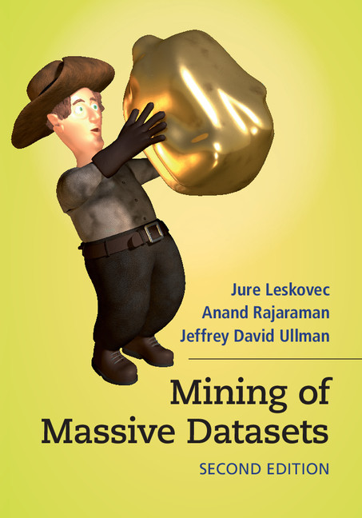

# Leskovec, Rajaraman, Ullman, *Mining of Massive Datasets*

[⬅ Back to tracker](../README.md)

## 📑 Table of Contents

1. [Data Mining](#ch1)
2. [MapReduce and the New Software Stack](#ch2)
3. [Finding Similar Items](#ch3) ⭐ *course*
4. [Mining Data Streams](#ch4)
5. [Link Analysis](#ch5)
6. [Frequent Itemsets](#ch6)
7. [Clustering](#ch7) ⭐ *course*
8. [Advertising on the Web](#ch8)
9. [Recommendation Systems](#ch9)
10. [Mining Social-Network Graphs](#ch10)
11. [Dimensionality Reduction](#ch11)
12. [Large-Scale Machine Learning](#ch12)
13. [Neural Nets and Deep Learning](#ch13)

### Ch. 1: Data Mining (p. 1)
- [ ] 1.1 What is Data Mining? (p. 1)
  - [ ] 1.1.1 Modeling (p. 1)
  - [ ] 1.1.2 Statistical Modeling (p. 2)
  - [ ] 1.1.3 Machine Learning (p. 2)
  - [ ] 1.1.4 Computational Approaches to Modeling (p. 3)
  - [ ] 1.1.5 Summarization (p. 4)
  - [ ] 1.1.6 Feature Extraction (p. 5)
- [ ] 1.2 Statistical Limits on Data Mining (p. 5)
  - [ ] 1.2.1 Total Information Awareness (p. 6)
  - [ ] 1.2.2 Bonferroni's Principle (p. 6)
  - [ ] 1.2.3 An Example of Bonferroni's Principle (p. 7)
  - [ ] 1.2.4 Exercises for Section 1.2 (p. 8)
- [ ] 1.3 Things Useful to Know (p. 8)
  - [ ] 1.3.1 Importance of Words in Documents (p. 9)
  - [ ] 1.3.2 Hash Functions (p. 10)
  - [ ] 1.3.3 Indexes (p. 11)
  - [ ] 1.3.4 Secondary Storage (p. 13)
  - [ ] 1.3.5 The Base of Natural Logarithms (p. 13)
  - [ ] 1.3.6 Power Laws (p. 14)
  - [ ] 1.3.7 Exercises for Section 1.3 (p. 16)
- [ ] 1.4 Outline of the Book (p. 17)
- [ ] 1.5 Summary of Chapter 1 (p. 19)
- [ ] 1.6 References for Chapter 1 (p. 19)

[⬆ Back to top](#top)

### Ch. 2: MapReduce and the New Software Stack (p. 21)
- [ ] 2.1 Distributed File Systems (p. 22)
  - [ ] 2.1.1 Physical Organization of Compute Nodes (p. 22)
  - [ ] 2.1.2 Large-Scale File-System Organization (p. 24)
- [ ] 2.2 MapReduce (p. 25)
  - [ ] 2.2.1 The Map Tasks (p. 25)
  - [ ] 2.2.2 Grouping by Key (p. 26)
  - [ ] 2.2.3 The Reduce Tasks (p. 27)
  - [ ] 2.2.4 Combiners (p. 27)
  - [ ] 2.2.5 Details of MapReduce Execution (p. 28)
  - [ ] 2.2.6 Coping With Node Failures (p. 30)
  - [ ] 2.2.7 Exercises for Section 2.2 (p. 30)
- [ ] 2.3 Algorithms Using MapReduce (p. 30)
  - [ ] 2.3.1 Matrix-Vector Multiplication by MapReduce (p. 31)
  - [ ] 2.3.2 If the Vector v Cannot Fit in Main Memory (p. 32)
  - [ ] 2.3.3 Relational-Algebra Operations (p. 33)
  - [ ] 2.3.4 Computing Selections by MapReduce (p. 35)
  - [ ] 2.3.5 Computing Projections by MapReduce (p. 36)
  - [ ] 2.3.6 Union, Intersection, and Difference by MapReduce (p. 36)
  - [ ] 2.3.7 Computing Natural Join by MapReduce (p. 37)
  - [ ] 2.3.8 Grouping and Aggregation by MapReduce (p. 38)
  - [ ] 2.3.9 Matrix Multiplication (p. 38)
  - [ ] 2.3.10 Matrix Multiplication with One MapReduce Step (p. 39)
  - [ ] 2.3.11 Exercises for Section 2.3 (p. 40)
- [ ] 2.4 Extensions to MapReduce (p. 41)
  - [ ] 2.4.1 Workflow Systems (p. 42)
  - [ ] 2.4.2 Spark (p. 43)
  - [ ] 2.4.3 Spark Implementation (p. 46)
  - [ ] 2.4.4 TensorFlow (p. 48)
  - [ ] 2.4.5 Recursive Extensions to MapReduce (p. 49)
  - [ ] 2.4.6 Bulk-Synchronous Systems (p. 51)
  - [ ] 2.4.7 Exercises for Section 2.4 (p. 53)
- [ ] 2.5 The Communication-Cost Model (p. 53)
  - [ ] 2.5.1 Communication Cost for Task Networks (p. 53)
  - [ ] 2.5.2 Wall-Clock Time (p. 55)
  - [ ] 2.5.3 Multiway Joins (p. 56)
  - [ ] 2.5.4 Exercises for Section 2.5 (p. 59)
- [ ] 2.6 Complexity Theory for MapReduce (p. 61)
  - [ ] 2.6.1 Reducer Size and Replication Rate (p. 61)
  - [ ] 2.6.2 An Example: Similarity Joins (p. 62)
  - [ ] 2.6.3 A Graph Model for MapReduce Problems (p. 64)
  - [ ] 2.6.4 Mapping Schemas (p. 65)
  - [ ] 2.6.5 When Not All Inputs Are Present (p. 67)
  - [ ] 2.6.6 Lower Bounds on Replication Rate (p. 68)
  - [ ] 2.6.7 Case Study: Matrix Multiplication (p. 69)
  - [ ] 2.6.8 Exercises for Section 2.6 (p. 73)
- [ ] 2.7 Summary of Chapter 2 (p. 74)
- [ ] 2.8 References for Chapter 2 (p. 77)

[⬆ Back to top](#top)

### Ch. 3: Finding Similar Items (p. 81) ⭐ *course*
- [ ] 3.1 Applications of Set Similarity (p. 82)
  - [ ] 3.1.1 Jaccard Similarity of Sets (p. 82)
  - [ ] 3.1.2 Similarity of Documents (p. 82)
  - [ ] 3.1.3 Collaborative Filtering as a Similar-Sets Problem (p. 84)
  - [ ] 3.1.4 Exercises for Section 3.1 (p. 86)
- [ ] 3.2 Shingling of Documents (p. 86)
  - [ ] 3.2.1 k-Shingles (p. 86)
  - [ ] 3.2.2 Choosing the Shingle Size (p. 87)
  - [ ] 3.2.3 Hashing Shingles (p. 87)
  - [ ] 3.2.4 Shingles Built from Words (p. 88)
  - [ ] 3.2.5 Exercises for Section 3.2 (p. 88)
- [ ] 3.3 Similarity-Preserving Summaries of Sets (p. 89)
  - [ ] 3.3.1 Matrix Representation of Sets (p. 89)
  - [ ] 3.3.2 Minhashing (p. 90)
  - [ ] 3.3.3 Minhashing and Jaccard Similarity (p. 91)
  - [ ] 3.3.4 Minhash Signatures (p. 91)
  - [ ] 3.3.5 Computing Minhash Signatures in Practice (p. 92)
  - [ ] 3.3.6 Speeding Up Minhashing (p. 94)
  - [ ] 3.3.7 Speedup Using Hash Functions (p. 95)
  - [ ] 3.3.8 Exercises for Section 3.3 (p. 98)
- [ ] 3.4 Locality-Sensitive Hashing for Documents (p. 99)
  - [ ] 3.4.1 LSH for Minhash Signatures (p. 100)
  - [ ] 3.4.2 Analysis of the Banding Technique (p. 101)
  - [ ] 3.4.3 Combining the Techniques (p. 103)
  - [ ] 3.4.4 Exercises for Section 3.4 (p. 104)
- [ ] 3.5 Distance Measures (p. 104) ⭐ *Oct 8, Oct 12*
  - [ ] 3.5.1 Definition of a Distance Measure (p. 105) ⭐ *Oct 8*
  - [ ] 3.5.2 Euclidean Distances (p. 105) ⭐ *Oct 8*
  - [ ] 3.5.3 Jaccard Distance (p. 106) ⭐ *Oct 8*
  - [ ] 3.5.4 Cosine Distance (p. 107)
  - [ ] 3.5.5 Edit Distance (p. 108) ⭐ *Oct 12*
  - [ ] 3.5.6 Hamming Distance (p. 109) ⭐ *Oct 8*
  - [ ] 3.5.7 Exercises for Section 3.5 (p. 109)
- [ ] 3.6 The Theory of Locality-Sensitive Functions (p. 111)
  - [ ] 3.6.1 Locality-Sensitive Functions (p. 112)
  - [ ] 3.6.2 Locality-Sensitive Families for Jaccard Distance (p. 112)
  - [ ] 3.6.3 Amplifying a Locality-Sensitive Family (p. 113)
  - [ ] 3.6.4 Exercises for Section 3.6 (p. 116)
- [ ] 3.7 LSH Families for Other Distance Measures (p. 116)
  - [ ] 3.7.1 LSH Families for Hamming Distance (p. 117)
  - [ ] 3.7.2 Random Hyperplanes and the Cosine Distance (p. 117)
  - [ ] 3.7.3 Sketches (p. 119)
  - [ ] 3.7.4 LSH Families for Euclidean Distance (p. 119)
  - [ ] 3.7.5 More LSH Families for Euclidean Spaces (p. 121)
  - [ ] 3.7.6 Exercises for Section 3.7 (p. 121)
- [ ] 3.8 Applications of Locality-Sensitive Hashing (p. 122)
  - [ ] 3.8.1 Entity Resolution (p. 123)
  - [ ] 3.8.2 An Entity-Resolution Example (p. 123)
  - [ ] 3.8.3 Validating Record Matches (p. 124)
  - [ ] 3.8.4 Matching Fingerprints (p. 125)
  - [ ] 3.8.5 A LSH Family for Fingerprint Matching (p. 126)
  - [ ] 3.8.6 Similar News Articles (p. 128)
  - [ ] 3.8.7 Exercises for Section 3.8 (p. 129)
- [ ] 3.9 Methods for High Degrees of Similarity (p. 130)
  - [ ] 3.9.1 Finding Identical Items (p. 130)
  - [ ] 3.9.2 Representing Sets as Strings (p. 131)
  - [ ] 3.9.3 Length-Based Filtering (p. 131)
  - [ ] 3.9.4 Prefix Indexing (p. 132)
  - [ ] 3.9.5 Using Position Information (p. 133)
  - [ ] 3.9.6 Using Position and Length in Indexes (p. 135)
  - [ ] 3.9.7 Exercises for Section 3.9 (p. 137)
- [ ] 3.10 Summary of Chapter 3 (p. 138)
- [ ] 3.11 References for Chapter 3 (p. 141)

[⬆ Back to top](#top)

### Ch. 4: Mining Data Streams (p. 143)
- [ ] 4.1 The Stream Data Model (p. 143)
  - [ ] 4.1.1 A Data-Stream-Management System (p. 144)
  - [ ] 4.1.2 Examples of Stream Sources (p. 145)
  - [ ] 4.1.3 Stream Queries (p. 146)
  - [ ] 4.1.4 Issues in Stream Processing (p. 147)
- [ ] 4.2 Sampling Data in a Stream (p. 148)
  - [ ] 4.2.1 A Motivating Example (p. 148)
  - [ ] 4.2.2 Obtaining a Representative Sample (p. 149)
  - [ ] 4.2.3 The General Sampling Problem (p. 149)
  - [ ] 4.2.4 Varying the Sample Size (p. 150)
  - [ ] 4.2.5 Exercises for Section 4.2 (p. 150)
- [ ] 4.3 Filtering Streams (p. 151)
  - [ ] 4.3.1 A Motivating Example (p. 151)
  - [ ] 4.3.2 The Bloom Filter (p. 152)
  - [ ] 4.3.3 Analysis of Bloom Filtering (p. 152)
  - [ ] 4.3.4 Exercises for Section 4.3 (p. 153)
- [ ] 4.4 Counting Distinct Elements in a Stream (p. 154)
  - [ ] 4.4.1 The Count-Distinct Problem (p. 154)
  - [ ] 4.4.2 The Flajolet-Martin Algorithm (p. 155)
  - [ ] 4.4.3 Combining Estimates (p. 156)
  - [ ] 4.4.4 Space Requirements (p. 156)
  - [ ] 4.4.5 Exercises for Section 4.4 (p. 157)
- [ ] 4.5 Estimating Moments (p. 157)
  - [ ] 4.5.1 Definition of Moments (p. 157)
  - [ ] 4.5.2 The Alon-Matias-Szegedy Algorithm for Second Moments (p. 158)
  - [ ] 4.5.3 Why the Alon-Matias-Szegedy Algorithm Works (p. 159)
  - [ ] 4.5.4 Higher-Order Moments (p. 160)
  - [ ] 4.5.5 Dealing With Infinite Streams (p. 160)
  - [ ] 4.5.6 Exercises for Section 4.5 (p. 161)
- [ ] 4.6 Counting Ones in a Window (p. 162)
  - [ ] 4.6.1 The Cost of Exact Counts (p. 163)
  - [ ] 4.6.2 The Datar-Gionis-Indyk-Motwani Algorithm (p. 163)
  - [ ] 4.6.3 Storage Requirements for the DGIM Algorithm (p. 165)
  - [ ] 4.6.4 Query Answering in the DGIM Algorithm (p. 165)
  - [ ] 4.6.5 Maintaining the DGIM Conditions (p. 166)
  - [ ] 4.6.6 Reducing the Error (p. 167)
  - [ ] 4.6.7 Extensions to the Counting of Ones (p. 168)
  - [ ] 4.6.8 Exercises for Section 4.6 (p. 169)
- [ ] 4.7 Decaying Windows (p. 169)
  - [ ] 4.7.1 The Problem of Most-Common Elements (p. 169)
  - [ ] 4.7.2 Definition of the Decaying Window (p. 170)
  - [ ] 4.7.3 Finding the Most Popular Elements (p. 171)
- [ ] 4.8 Summary of Chapter 4 (p. 172)
- [ ] 4.9 References for Chapter 4 (p. 173)

[⬆ Back to top](#top)

### Ch. 5: Link Analysis (p. 175)
- [ ] 5.1 PageRank (p. 175)
  - [ ] 5.1.1 Early Search Engines and Term Spam (p. 176)
  - [ ] 5.1.2 Definition of PageRank (p. 177)
  - [ ] 5.1.3 Structure of the Web (p. 181)
  - [ ] 5.1.4 Avoiding Dead Ends (p. 182)
  - [ ] 5.1.5 Spider Traps and Taxation (p. 185)
  - [ ] 5.1.6 Using PageRank in a Search Engine (p. 187)
  - [ ] 5.1.7 Exercises for Section 5.1 (p. 187)
- [ ] 5.2 Efficient Computation of PageRank (p. 189)
  - [ ] 5.2.1 Representing Transition Matrices (p. 190)
  - [ ] 5.2.2 PageRank Iteration Using MapReduce (p. 191)
  - [ ] 5.2.3 Use of Combiners to Consolidate the Result Vector (p. 191)
  - [ ] 5.2.4 Representing Blocks of the Transition Matrix (p. 192)
  - [ ] 5.2.5 Other Efficient Approaches to PageRank Iteration (p. 193)
  - [ ] 5.2.6 Exercises for Section 5.2 (p. 195)
- [ ] 5.3 Topic-Sensitive PageRank (p. 195)
  - [ ] 5.3.1 Motivation for Topic-Sensitive PageRank (p. 195)
  - [ ] 5.3.2 Biased Random Walks (p. 196)
  - [ ] 5.3.3 Using Topic-Sensitive PageRank (p. 197)
  - [ ] 5.3.4 Inferring Topics from Words (p. 198)
  - [ ] 5.3.5 Exercises for Section 5.3 (p. 199)
- [ ] 5.4 Link Spam (p. 199)
  - [ ] 5.4.1 Architecture of a Spam Farm (p. 199)
  - [ ] 5.4.2 Analysis of a Spam Farm (p. 201)
  - [ ] 5.4.3 Combating Link Spam (p. 202)
  - [ ] 5.4.4 TrustRank (p. 202)
  - [ ] 5.4.5 Spam Mass (p. 203)
  - [ ] 5.4.6 Exercises for Section 5.4 (p. 203)
- [ ] 5.5 Hubs and Authorities (p. 204)
  - [ ] 5.5.1 The Intuition Behind HITS (p. 204)
  - [ ] 5.5.2 Formalizing Hubbiness and Authority (p. 205)
  - [ ] 5.5.3 Exercises for Section 5.5 (p. 208)
- [ ] 5.6 Summary of Chapter 5 (p. 208)
- [ ] 5.7 References for Chapter 5 (p. 212)

[⬆ Back to top](#top)

### Ch. 6: Frequent Itemsets (p. 213)
- [ ] 6.1 The Market-Basket Model (p. 214)
  - [ ] 6.1.1 Definition of Frequent Itemsets (p. 214)
  - [ ] 6.1.2 Applications of Frequent Itemsets (p. 216)
  - [ ] 6.1.3 Association Rules (p. 217)
  - [ ] 6.1.4 Finding Association Rules with High Confidence (p. 219)
  - [ ] 6.1.5 Exercises for Section 6.1 (p. 219)
- [ ] 6.2 Market Baskets and the A-Priori Algorithm (p. 221)
  - [ ] 6.2.1 Representation of Market-Basket Data (p. 221)
  - [ ] 6.2.2 Use of Main Memory for Itemset Counting (p. 222)
  - [ ] 6.2.3 Monotonicity of Itemsets (p. 224)
  - [ ] 6.2.4 Tyranny of Counting Pairs (p. 225)
  - [ ] 6.2.5 The A-Priori Algorithm (p. 225)
  - [ ] 6.2.6 A-Priori for All Frequent Itemsets (p. 226)
  - [ ] 6.2.7 Exercises for Section 6.2 (p. 229)
- [ ] 6.3 Handling Larger Datasets in Main Memory (p. 230)
  - [ ] 6.3.1 The Algorithm of Park, Chen, and Yu (p. 230)
  - [ ] 6.3.2 The Multistage Algorithm (p. 232)
  - [ ] 6.3.3 The Multihash Algorithm (p. 234)
  - [ ] 6.3.4 Exercises for Section 6.3 (p. 236)
- [ ] 6.4 Limited-Pass Algorithms (p. 238)
  - [ ] 6.4.1 The Simple, Randomized Algorithm (p. 238)
  - [ ] 6.4.2 Avoiding Errors in Sampling Algorithms (p. 239)
  - [ ] 6.4.3 The Algorithm of Savasere, Omiecinski, and Navathe (p. 240)
  - [ ] 6.4.4 The SON Algorithm and MapReduce (p. 241)
  - [ ] 6.4.5 Toivonen's Algorithm (p. 242)
  - [ ] 6.4.6 Why Toivonen's Algorithm Works (p. 243)
  - [ ] 6.4.7 Exercises for Section 6.4 (p. 244)
- [ ] 6.5 Counting Frequent Items in a Stream (p. 244)
  - [ ] 6.5.1 Sampling Methods for Streams (p. 245)
  - [ ] 6.5.2 Frequent Itemsets in Decaying Windows (p. 246)
  - [ ] 6.5.3 Hybrid Methods (p. 247)
  - [ ] 6.5.4 Exercises for Section 6.5 (p. 247)
- [ ] 6.6 Summary of Chapter 6 (p. 248)
- [ ] 6.7 References for Chapter 6 (p. 250)

[⬆ Back to top](#top)

### Ch. 7: Clustering (p. 253) ⭐ *course*
- [ ] 7.1 Introduction to Clustering Techniques (p. 253) ⭐ *Nov 5*
  - [ ] 7.1.1 Points, Spaces, and Distances (p. 253) ⭐ *Nov 5*
  - [ ] 7.1.2 Clustering Strategies (p. 255) ⭐ *Nov 5*
  - [ ] 7.1.3 The Curse of Dimensionality (p. 256) ⭐ *Nov 5*
  - [ ] 7.1.4 Exercises for Section 7.1 (p. 257)
- [ ] 7.2 Hierarchical Clustering (p. 257) ⭐ *Nov 5*
  - [ ] 7.2.1 Hierarchical Clustering in a Euclidean Space (p. 258) ⭐ *Nov 5*
  - [ ] 7.2.2 Efficiency of Hierarchical Clustering (p. 260) ⭐ *Nov 5*
  - [ ] 7.2.3 Alternative Rules for Controlling Hierarchical Clustering (p. 261) ⭐ *Nov 5*
  - [ ] 7.2.4 Hierarchical Clustering in Non-Euclidean Spaces (p. 264) ⭐ *Nov 5*
  - [ ] 7.2.5 Exercises for Section 7.2 (p. 265)
- [ ] 7.3 K-means Algorithms (p. 266) ⭐ *Nov 9*
  - [ ] 7.3.1 K-Means Basics (p. 267) ⭐ *Nov 9*
  - [ ] 7.3.2 Initializing Clusters for K-Means (p. 267) ⭐ *Nov 9*
  - [ ] 7.3.3 Picking the Right Value of k (p. 268) ⭐ *Nov 9*
  - [ ] 7.3.4 The Algorithm of Bradley, Fayyad, and Reina (p. 269) ⭐ *Nov 9*
  - [ ] 7.3.5 Processing Data in the BFR Algorithm (p. 271) ⭐ *Nov 9*
  - [ ] 7.3.6 Exercises for Section 7.3 (p. 274)
- [ ] 7.4 The CURE Algorithm (p. 274)
  - [ ] 7.4.1 Initialization in CURE (p. 275)
  - [ ] 7.4.2 Completion of the CURE Algorithm (p. 276)
  - [ ] 7.4.3 Exercises for Section 7.4 (p. 277)
- [ ] 7.5 Clustering in Non-Euclidean Spaces (p. 278)
  - [ ] 7.5.1 Representing Clusters in the GRGPF Algorithm (p. 278)
  - [ ] 7.5.2 Initializing the Cluster Tree (p. 279)
  - [ ] 7.5.3 Adding Points in the GRGPF Algorithm (p. 280)
  - [ ] 7.5.4 Splitting and Merging Clusters (p. 281)
  - [ ] 7.5.5 Exercises for Section 7.5 (p. 282)
- [ ] 7.6 Clustering for Streams and Parallelism (p. 282)
  - [ ] 7.6.1 The Stream-Computing Model (p. 283)
  - [ ] 7.6.2 A Stream-Clustering Algorithm (p. 283)
  - [ ] 7.6.3 Initializing Buckets (p. 284)
  - [ ] 7.6.4 Merging Buckets (p. 284)
  - [ ] 7.6.5 Answering Queries (p. 287)
  - [ ] 7.6.6 Clustering in a Parallel Environment (p. 287)
  - [ ] 7.6.7 Exercises for Section 7.6 (p. 288)
- [ ] 7.7 Summary of Chapter 7 (p. 288)
- [ ] 7.8 References for Chapter 7 (p. 292)

[⬆ Back to top](#top)

### Ch. 8: Advertising on the Web (p. 293)
- [ ] 8.1 Issues in On-Line Advertising (p. 293)
  - [ ] 8.1.1 Advertising Opportunities (p. 293)
  - [ ] 8.1.2 Direct Placement of Ads (p. 294)
  - [ ] 8.1.3 Issues for Display Ads (p. 295)
- [ ] 8.2 On-Line Algorithms (p. 296)
  - [ ] 8.2.1 On-Line and Off-Line Algorithms (p. 296)
  - [ ] 8.2.2 Greedy Algorithms (p. 297)
  - [ ] 8.2.3 The Competitive Ratio (p. 298)
  - [ ] 8.2.4 Exercises for Section 8.2 (p. 298)
- [ ] 8.3 The Matching Problem (p. 299)
  - [ ] 8.3.1 Matches and Perfect Matches (p. 299)
  - [ ] 8.3.2 The Greedy Algorithm for Maximal Matching (p. 300)
  - [ ] 8.3.3 Competitive Ratio for Greedy Matching (p. 301)
  - [ ] 8.3.4 Exercises for Section 8.3 (p. 302)
- [ ] 8.4 The Adwords Problem (p. 302)
  - [ ] 8.4.1 History of Search Advertising (p. 303)
  - [ ] 8.4.2 Definition of the Adwords Problem (p. 303)
  - [ ] 8.4.3 The Greedy Approach to the Adwords Problem (p. 304)
  - [ ] 8.4.4 The Balance Algorithm (p. 305)
  - [ ] 8.4.5 A Lower Bound on Competitive Ratio for Balance (p. 306)
  - [ ] 8.4.6 The Balance Algorithm with Many Bidders (p. 308)
  - [ ] 8.4.7 The Generalized Balance Algorithm (p. 309)
  - [ ] 8.4.8 Final Observations About the Adwords Problem (p. 310)
  - [ ] 8.4.9 Exercises for Section 8.4 (p. 311)
- [ ] 8.5 Adwords Implementation (p. 311)
  - [ ] 8.5.1 Matching Bids and Search Queries (p. 312)
  - [ ] 8.5.2 More Complex Matching Problems (p. 312)
  - [ ] 8.5.3 A Matching Algorithm for Documents and Bids (p. 313)
- [ ] 8.6 Summary of Chapter 8 (p. 315)
- [ ] 8.7 References for Chapter 8 (p. 317)

[⬆ Back to top](#top)

### Ch. 9: Recommendation Systems (p. 319)
- [ ] 9.1 A Model for Recommendation Systems (p. 319)
  - [ ] 9.1.1 The Utility Matrix (p. 320)
  - [ ] 9.1.2 The Long Tail (p. 321)
  - [ ] 9.1.3 Applications of Recommendation Systems (p. 321)
  - [ ] 9.1.4 Populating the Utility Matrix (p. 323)
- [ ] 9.2 Content-Based Recommendations (p. 324)
  - [ ] 9.2.1 Item Profiles (p. 324)
  - [ ] 9.2.2 Discovering Features of Documents (p. 325)
  - [ ] 9.2.3 Obtaining Item Features From Tags (p. 326)
  - [ ] 9.2.4 Representing Item Profiles (p. 327)
  - [ ] 9.2.5 User Profiles (p. 328)
  - [ ] 9.2.6 Recommending Items to Users Based on Content (p. 329)
  - [ ] 9.2.7 Classification Algorithms (p. 330)
  - [ ] 9.2.8 Exercises for Section 9.2 (p. 332)
- [ ] 9.3 Collaborative Filtering (p. 333)
  - [ ] 9.3.1 Measuring Similarity (p. 334)
  - [ ] 9.3.2 The Duality of Similarity (p. 336)
  - [ ] 9.3.3 Clustering Users and Items (p. 337)
  - [ ] 9.3.4 Exercises for Section 9.3 (p. 339)
- [ ] 9.4 Dimensionality Reduction (p. 340)
  - [ ] 9.4.1 UV-Decomposition (p. 340)
  - [ ] 9.4.2 Root-Mean-Square Error (p. 341)
  - [ ] 9.4.3 Incremental Computation of a UV-Decomposition (p. 342)
  - [ ] 9.4.4 Optimizing an Arbitrary Element (p. 344)
  - [ ] 9.4.5 Building a Complete UV-Decomposition Algorithm (p. 346)
  - [ ] 9.4.6 Exercises for Section 9.4 (p. 348)
- [ ] 9.5 The Netflix Challenge (p. 349)
- [ ] 9.6 Summary of Chapter 9 (p. 350)
- [ ] 9.7 References for Chapter 9 (p. 352)

[⬆ Back to top](#top)

### Ch. 10: Mining Social-Network Graphs (p. 355)
- [ ] 10.1 Social Networks as Graphs (p. 356)
  - [ ] 10.1.1 What is a Social Network? (p. 356)
  - [ ] 10.1.2 Social Networks as Graphs (p. 356)
  - [ ] 10.1.3 Varieties of Social Networks (p. 358)
  - [ ] 10.1.4 Graphs With Several Node Types (p. 359)
  - [ ] 10.1.5 Exercises for Section 10.1 (p. 360)
- [ ] 10.2 Clustering of Social-Network Graphs (p. 361)
  - [ ] 10.2.1 Distance Measures for Social-Network Graphs (p. 361)
  - [ ] 10.2.2 Applying Standard Clustering Methods (p. 361)
  - [ ] 10.2.3 Betweenness (p. 363)
  - [ ] 10.2.4 The Girvan-Newman Algorithm (p. 363)
  - [ ] 10.2.5 Using Betweenness to Find Communities (p. 366)
  - [ ] 10.2.6 Exercises for Section 10.2 (p. 367)
- [ ] 10.3 Direct Discovery of Communities (p. 368)
  - [ ] 10.3.1 Finding Cliques (p. 369)
  - [ ] 10.3.2 Complete Bipartite Graphs (p. 369)
  - [ ] 10.3.3 Finding Complete Bipartite Subgraphs (p. 370)
  - [ ] 10.3.4 Why Complete Bipartite Graphs Must Exist (p. 371)
  - [ ] 10.3.5 Exercises for Section 10.3 (p. 373)
- [ ] 10.4 Partitioning of Graphs (p. 374)
  - [ ] 10.4.1 What Makes a Good Partition? (p. 374)
  - [ ] 10.4.2 Normalized Cuts (p. 375)
  - [ ] 10.4.3 Some Matrices That Describe Graphs (p. 375)
  - [ ] 10.4.4 Eigenvalues of the Laplacian Matrix (p. 377)
  - [ ] 10.4.5 Alternative Partitioning Methods (p. 379)
  - [ ] 10.4.6 Exercises for Section 10.4 (p. 380)
- [ ] 10.5 Finding Overlapping Communities (p. 381)
  - [ ] 10.5.1 The Nature of Communities (p. 381)
  - [ ] 10.5.2 Maximum-Likelihood Estimation (p. 381)
  - [ ] 10.5.3 The Affiliation-Graph Model (p. 383)
  - [ ] 10.5.4 Discrete Optimization of Community Assignments (p. 385)
  - [ ] 10.5.5 Avoiding the Use of Discrete Membership Changes (p. 386)
  - [ ] 10.5.6 Exercises for Section 10.5 (p. 388)
- [ ] 10.6 SimRank (p. 389)
  - [ ] 10.6.1 Random Walkers on a Social Graph (p. 390)
  - [ ] 10.6.2 Random Walks with Restart (p. 391)
  - [ ] 10.6.3 Approximate SimRank (p. 393)
  - [ ] 10.6.4 Why Approximate SimRank Works (p. 395)
  - [ ] 10.6.5 Application of SimRank to Finding Communities (p. 396)
  - [ ] 10.6.6 Exercises for Section 10.6 (p. 397)
- [ ] 10.7 Counting Triangles (p. 399)
  - [ ] 10.7.1 Why Count Triangles? (p. 399)
  - [ ] 10.7.2 An Algorithm for Finding Triangles (p. 400)
  - [ ] 10.7.3 Optimality of the Triangle-Finding Algorithm (p. 401)
  - [ ] 10.7.4 Finding Triangles Using MapReduce (p. 401)
  - [ ] 10.7.5 Using Fewer Reduce Tasks (p. 403)
  - [ ] 10.7.6 Exercises for Section 10.7 (p. 404)
- [ ] 10.8 Neighborhood Properties of Graphs (p. 405)
  - [ ] 10.8.1 Directed Graphs and Neighborhoods (p. 405)
  - [ ] 10.8.2 The Diameter of a Graph (p. 406)
  - [ ] 10.8.3 Transitive Closure and Reachability (p. 407)
  - [ ] 10.8.4 Reachability Via MapReduce (p. 408)
  - [ ] 10.8.5 Seminaive Evaluation (p. 409)
  - [ ] 10.8.6 Linear Transitive Closure (p. 410)
  - [ ] 10.8.7 Transitive Closure by Recursive Doubling (p. 411)
  - [ ] 10.8.8 Smart Transitive Closure (p. 413)
  - [ ] 10.8.9 Comparison of Methods (p. 415)
  - [ ] 10.8.10 Transitive Closure by Graph Reduction (p. 417)
  - [ ] 10.8.11 Approximating the Sizes of Neighborhoods (p. 418)
  - [ ] 10.8.12 Exercises for Section 10.8 (p. 420)
- [ ] 10.9 Summary of Chapter 10 (p. 422)
- [ ] 10.10 References for Chapter 10 (p. 425)

[⬆ Back to top](#top)

### Ch. 11: Dimensionality Reduction (p. 429)
- [ ] 11.1 Eigenvalues and Eigenvectors of Symmetric Matrices (p. 430)
  - [ ] 11.1.1 Definitions (p. 430)
  - [ ] 11.1.2 Computing Eigenvalues and Eigenvectors (p. 431)
  - [ ] 11.1.3 Finding Eigenpairs by Power Iteration (p. 432)
  - [ ] 11.1.4 The Matrix of Eigenvectors (p. 435)
  - [ ] 11.1.5 Exercises for Section 11.1 (p. 435)
- [ ] 11.2 Principal-Component Analysis (p. 436)
  - [ ] 11.2.1 An Illustrative Example (p. 437)
  - [ ] 11.2.2 Using Eigenvectors for Dimensionality Reduction (p. 440)
  - [ ] 11.2.3 The Matrix of Distances (p. 441)
  - [ ] 11.2.4 Exercises for Section 11.2 (p. 442)
- [ ] 11.3 Singular-Value Decomposition (p. 442)
  - [ ] 11.3.1 Definition of SVD (p. 442)
  - [ ] 11.3.2 Interpretation of SVD (p. 444)
  - [ ] 11.3.3 Dimensionality Reduction Using SVD (p. 446)
  - [ ] 11.3.4 Why Zeroing Low Singular Values Works (p. 447)
  - [ ] 11.3.5 Querying Using Concepts (p. 449)
  - [ ] 11.3.6 Computing the SVD of a Matrix (p. 450)
  - [ ] 11.3.7 Exercises for Section 11.3 (p. 451)
- [ ] 11.4 CUR Decomposition (p. 452)
  - [ ] 11.4.1 Definition of CUR (p. 453)
  - [ ] 11.4.2 Choosing Rows and Columns Properly (p. 454)
  - [ ] 11.4.3 Constructing the Middle Matrix (p. 455)
  - [ ] 11.4.4 The Complete CUR Decomposition (p. 456)
  - [ ] 11.4.5 Eliminating Duplicate Rows and Columns (p. 457)
  - [ ] 11.4.6 Exercises for Section 11.4 (p. 458)
- [ ] 11.5 Summary of Chapter 11 (p. 458)
- [ ] 11.6 References for Chapter 11 (p. 460)

[⬆ Back to top](#top)

### Ch. 12: Large-Scale Machine Learning (p. 463)
- [ ] 12.1 The Machine-Learning Model (p. 464)
  - [ ] 12.1.1 Training Sets (p. 464)
  - [ ] 12.1.2 Some Illustrative Examples (p. 464)
  - [ ] 12.1.3 Approaches to Machine Learning (p. 467)
  - [ ] 12.1.4 Machine-Learning Architecture (p. 468)
  - [ ] 12.1.5 Exercises for Section 12.1 (p. 471)
- [ ] 12.2 Perceptrons (p. 471)
  - [ ] 12.2.1 Training a Perceptron with Zero Threshold (p. 471)
  - [ ] 12.2.2 Convergence of Perceptrons (p. 475)
  - [ ] 12.2.3 The Winnow Algorithm (p. 475)
  - [ ] 12.2.4 Allowing the Threshold to Vary (p. 477)
  - [ ] 12.2.5 Multiclass Perceptrons (p. 479)
  - [ ] 12.2.6 Transforming the Training Set (p. 480)
  - [ ] 12.2.7 Problems With Perceptrons (p. 481)
  - [ ] 12.2.8 Parallel Implementation of Perceptrons (p. 482)
  - [ ] 12.2.9 Exercises for Section 12.2 (p. 484)
- [ ] 12.3 Support-Vector Machines (p. 485)
  - [ ] 12.3.1 The Mechanics of an SVM (p. 486)
  - [ ] 12.3.2 Normalizing the Hyperplane (p. 487)
  - [ ] 12.3.3 Finding Optimal Approximate Separators (p. 489)
  - [ ] 12.3.4 SVM Solutions by Gradient Descent (p. 492)
  - [ ] 12.3.5 Stochastic Gradient Descent (p. 495)
  - [ ] 12.3.6 Parallel Implementation of SVM (p. 496)
  - [ ] 12.3.7 Exercises for Section 12.3 (p. 497)
- [ ] 12.4 Learning from Nearest Neighbors (p. 497)
  - [ ] 12.4.1 The Framework for Nearest-Neighbor Calculations (p. 498)
  - [ ] 12.4.2 Learning with One Nearest Neighbor (p. 498)
  - [ ] 12.4.3 Learning One-Dimensional Functions (p. 499)
  - [ ] 12.4.4 Kernel Regression (p. 502)
  - [ ] 12.4.5 Dealing with High-Dimensional Euclidean Data (p. 502)
  - [ ] 12.4.6 Dealing with Non-Euclidean Distances (p. 504)
  - [ ] 12.4.7 Exercises for Section 12.4 (p. 504)
- [ ] 12.5 Decision Trees (p. 505)
  - [ ] 12.5.1 Using a Decision Tree (p. 506)
  - [ ] 12.5.2 Impurity Measures (p. 507)
  - [ ] 12.5.3 Designing a Decision-Tree Node (p. 508)
  - [ ] 12.5.4 Selecting a Test Using a Numerical Feature (p. 509)
  - [ ] 12.5.5 Selecting a Test Using a Categorical Feature (p. 511)
  - [ ] 12.5.6 Parallel Design of Decision Trees (p. 513)
  - [ ] 12.5.7 Node Pruning (p. 514)
  - [ ] 12.5.8 Decision Forests (p. 515)
  - [ ] 12.5.9 Exercises for Section 12.5 (p. 516)
- [ ] 12.6 Comparison of Learning Methods (p. 517)
- [ ] 12.7 Summary of Chapter 12 (p. 518)
- [ ] 12.8 References for Chapter 12 (p. 520)

[⬆ Back to top](#top)

### Ch. 13: Neural Nets and Deep Learning (p. 523)
- [ ] 13.1 Introduction to Neural Nets (p. 524)
  - [ ] 13.1.1 Neural Nets, in General (p. 525)
  - [ ] 13.1.2 Interconnections Among Nodes (p. 527)
  - [ ] 13.1.3 Convolutional Neural Networks (p. 527)
  - [ ] 13.1.4 Design Issues for Neural Nets (p. 528)
  - [ ] 13.1.5 Exercises for Section 13.1 (p. 528)
- [ ] 13.2 Dense Feedforward Networks (p. 529)
  - [ ] 13.2.1 Linear Algebra Notation (p. 529)
  - [ ] 13.2.2 Activation Functions (p. 531)
  - [ ] 13.2.3 The Sigmoid (p. 532)
  - [ ] 13.2.4 The Hyperbolic Tangent (p. 532)
  - [ ] 13.2.5 Softmax (p. 533)
  - [ ] 13.2.6 Rectified Linear Unit (p. 534)
  - [ ] 13.2.7 Loss Functions (p. 535)
  - [ ] 13.2.8 Regression Loss (p. 536)
  - [ ] 13.2.9 Classification Loss (p. 537)
  - [ ] 13.2.10 Exercises for Section 13.2 (p. 538)
- [ ] 13.3 Backpropagation and Gradient Descent (p. 539)
  - [ ] 13.3.1 Compute Graphs (p. 540)
  - [ ] 13.3.2 Gradients, Jacobians, and the Chain Rule (p. 541)
  - [ ] 13.3.3 The Backpropagation Algorithm (p. 542)
  - [ ] 13.3.4 Iterating Gradient Descent (p. 545)
  - [ ] 13.3.5 Tensors (p. 546)
  - [ ] 13.3.6 Exercises for Section 13.3 (p. 548)
- [ ] 13.4 Convolutional Neural Networks (p. 548)
  - [ ] 13.4.1 Convolutional Layers (p. 549)
  - [ ] 13.4.2 Convolution and Cross-Correlation (p. 552)
  - [ ] 13.4.3 Pooling Layers (p. 553)
  - [ ] 13.4.4 CNN Architecture (p. 553)
  - [ ] 13.4.5 Implementation and Training (p. 555)
  - [ ] 13.4.6 Exercises for Section 13.4 (p. 556)
- [ ] 13.5 Recurrent Neural Networks (p. 557)
  - [ ] 13.5.1 Training RNNs (p. 559)
  - [ ] 13.5.2 Vanishing and Exploding Gradients (p. 561)
  - [ ] 13.5.3 Long Short-Term Memory (LSTM) (p. 562)
  - [ ] 13.5.4 Exercises for Section 13.5 (p. 564)
- [ ] 13.6 Regularization (p. 565)
  - [ ] 13.6.1 Norm Penalties (p. 565)
  - [ ] 13.6.2 Dropout (p. 566)
  - [ ] 13.6.3 Early Stopping (p. 566)
  - [ ] 13.6.4 Dataset Augmentation (p. 567)
- [ ] 13.7 Summary of Chapter 13 (p. 567)
- [ ] 13.8 References for Chapter 13 (p. 569)

[⬆ Back to top](#top)
