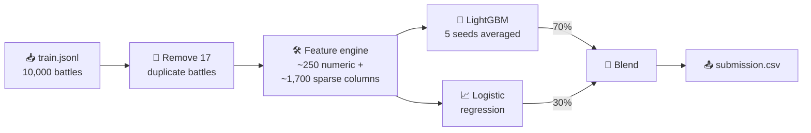
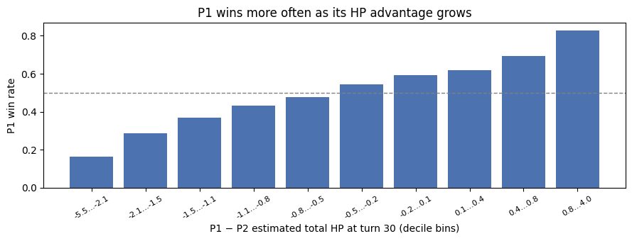
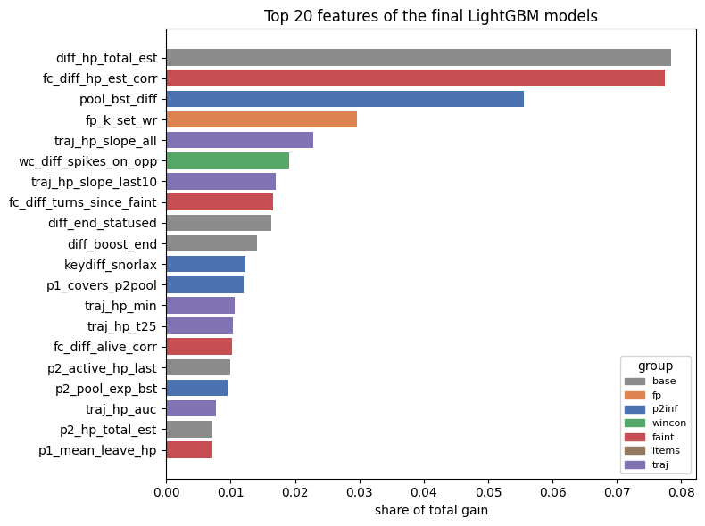

<div align="center">

# 🚀 Team Rocket
### Predicting Gen 2 OU Pokémon battles after just 30 turns

*Who wins the battle, before the battle is over?*


</div>

---

## 🎯 The challenge

The *FDS Pokémon Battles Prediction 2026* Kaggle competition gave us thousands of **real human-vs-human battles** from Pokémon Showdown's *Generation 2 OverUsed* tier. For each one, it gave us:

- 🧢 **Player 1's full team**: six Pokémon with types, levels, base stats and items.
- 👀 **Player 2's lead**: one Pokémon, and that's all we know about P2's team.
- 📜 **The first 30 turns**: who was on the field, their HP, status and every move used.

The task: predict **whether Player 1 wins**, scored on accuracy, using classical ML only. The catch is that the game is usually far from over at turn 30, and most of Player 2's team is still hiding behind a Poké Ball.

## 🏆 How we did

<div align="center">

| | Accuracy |
|:---|:---:|
| 🪙 Coin flip (classes are exactly 50/50) | 50.0% |
| 🌱 Our first baseline | 68.1% |
| 🧪 **Final model, cross-validation** | **69.3% ± 0.7** |
| 🥇 **Final model, full leaderboard** | **68.28%, top 10** |

</div>

> 💡 **Is a 1-point drop on the leaderboard a problem?** No. A 5,000-battle test set alone carries a standard error of about ±0.65 points, so our cross-validation predicted the leaderboard about as well as it statistically could.

---

## ⚔️ A battle, turn by turn

Here is the very first battle in the training set:

| Turn | 🔴 Player 1 | 🔵 Player 2 |
|:---:|:---|:---|
| 1 | **Tyranitar** uses Earthquake | **Forretress** uses Toxic (86% HP left) |
| 2 | switches to **Typhlosion**, which gets badly poisoned | Forretress uses Toxic again |
| 3 | Typhlosion uses Fire Blast | switches to **Zapdos** (drops to 61%) |
| 4 | Typhlosion hits Fire Blast again (Zapdos at 26%) | Zapdos' Hidden Power leaves Typhlosion at **3%** |
| 5 | Typhlosion uses Rest and heals to full | switches to **Snorlax** |

…and 25 turns later, **Player 1 lost.** Our model has to read stories like this one and call the ending.

---

## 🧠 How the model thinks



### 🕵️ Clue #1: the log is hiding P2's faints

While exploring the data we noticed something odd:

| | 🔴 Player 1 | 🔵 Player 2 |
|:---|:---:|:---:|
| Recorded faints per battle | **1.69** | **0.50** |
| Left the field at ≤15% HP, *no faint recorded* | 0.12 | **0.28** |

P1 wins exactly half the time, yet appears to lose three times as many Pokémon. Meanwhile P2's Pokémon keep vanishing at almost no HP without a recorded faint. Our reading: **many of P2's faints are missing from the log.** That clue became a whole feature group.

### 🧩 Clue #2: Showdown players reuse their teams

There are no player IDs in the data, but the exact same team showing up again is very likely the same person, and some players are simply better. A team's past win rate became a **player fingerprint**.

### 🛠️ The feature groups

Every battle becomes one row. Most features come as P1, P2 and P1 − P2.

| | Group | What it captures |
|:---:|:---|:---|
| ⚪ | `base` | The state at turn 30: who's alive, HP, statuses, moves used, type matchups (Gen 2 chart). Star feature: **estimated total HP remaining** |
| 🔵 | `p2inf` | A guess at P2's **hidden Pokémon**, using which species tend to appear together on teams |
| 🟢 | `wincon` | **Win conditions**: boosted sweepers, Explosion, Spikes, sleep, recovery |
| 🔴 | `faint` | Pokémon that left at very low HP and **never came back**, counted as probably fainted |
| 🟤 | `items` | P1's held items, such as Leftovers and berries |
| 🟣 | `traj` | The **momentum curve**: how the HP lead moved over all 30 turns, plus speed control |
| 🟠 | `fp` | The **player fingerprint**: smoothed win rate of P1's exact team and species set |

> 🔒 **No peeking.** The fingerprint uses labels, so it is computed *out-of-fold*: a battle never contributes to its own feature, and in cross-validation only that fold's training data is used.

<p align="center">
  
</p>
<p align="center"><em>The more HP P1 has left at turn 30, the more often it wins. But even the best position isn't a sure thing, which is what the other groups go after.</em></p>

### 🤝 Two models, one prediction

```
P(Player 1 wins) = 0.7 × LightGBM + 0.3 × logistic regression
```

- 🌳 **LightGBM** spots interactions such as "ahead on HP, *but* P2 has Spikes up". It uses small, randomised trees (7 leaves, 1,500 rounds) averaged over 5 seeds.
- 📈 **Logistic regression** (strongly regularised, C = 0.01) is weaker on its own but makes *different* mistakes, so the blend beats both.

---

## 🔬 How we kept ourselves honest

- **Same splits for everyone.** Every idea was tested with 5-fold stratified cross-validation repeated twice, with all variants scored on the *same* 10 splits.
- **Log-loss as the compass.** Accuracy jumps around on 2,000-battle folds; log-loss is steadier. An idea had to win **most of the 10 splits** to stay.
- **A final exam on fresh splits.** The finished pipeline was re-measured on 5 splits never used for any decision. That gives the 69.3% above.

<details>
<summary><b>📊 Ablation: what happens if we remove each group?</b> (click to expand)</summary>

<br>

LightGBM only, same 10 splits. Higher log-loss is worse.

| Variant | Accuracy | Log-loss | Worse without it in |
|:---|:---:|:---:|:---:|
| All six groups | 68.80% | 0.5768 | — |
| − 🟠 `fp` | 68.47% | 0.5806 | 9/10 splits |
| − 🟢 `wincon` | 68.64% | 0.5800 | **10/10** |
| − 🔵 `p2inf` | 68.77% | 0.5781 | 8/10 |
| − 🔴 `faint` | 68.56% | 0.5779 | 8/10 |
| − 🟤 `items` | 68.72% | 0.5775 | 7/10 |
| − 🟣 `traj` | 68.79% | 0.5763 | 5/10 (neutral) |

Added one at a time, only `fp` and `wincon` helped clearly. Together, the six groups improved log-loss in **all 10 splits**: they work as a team. 🚀

</details>

<p align="center">
  
</p>
<p align="center"><em>What the trees lean on most. The raw HP difference and its "missing faints" correction are neck and neck at the top.</em></p>

---

## 📁 What's inside

```
.
├── 2026fds-team-rocket-final-model.ipynb   🧪 the full pipeline: EDA → features → experiments → submission
├── figures/                                🖼️ figures used in this README
├── report/                                 📄 one-page report (LaTeX sources + PDF)
└── README.md
```

## 🚧 What still beats us

- 🙈 **Hidden information.** We never see P2's back line, items or unused moves; our guess at P2's team is a population average.
- ⏳ **Unfinished games.** Many battles are still wide open at turn 30, so part of the error is probably irreducible.
- 🔍 **Missing faints are a heuristic.** Some real faints slip through, and some Pokémon kept in reserve get wrongly flagged.
- 🧬 **Fingerprint coverage.** Only about 11% of test battles share an exact team with a training battle.
- 🎲 **Leaderboard noise.** Differences under about one point between submissions are within noise.

---

<div align="center">

### 👥 Team Rocket

*Member 1* · *Member 2* · *Member 3*

*Prepare for trouble… and make it double-checked.* 🚀

</div>
